# Icon gallery

189 icons in 3 themes (dark, light, brand). Use the **id** with the skill's scripts, e.g. `compose.py react,ts -o stack.svg`.

> Generated by `npm run build`. Don't edit this folder by hand. It is not part of the skill.

Logos are from [Simple Icons](https://simpleicons.org) and are trademarks of their owners. Licences vary per logo; "-" means Simple Icons has no licence data, which does not mean it's free to use.

[ai](#ai) · [backend](#backend) · [cloud](#cloud) · [database](#database) · [design](#design) · [devops](#devops) · [frontend](#frontend) · [language](#language) · [mobile](#mobile) · [os](#os) · [tools](#tools)

## ai

| Dark | Light | Brand | id | Name | Aliases | Licence | Brand guidelines |
|:-:|:-:|:-:|---|---|---|---|---|
|  |  |  | `anthropic` | Anthropic | - | - | - |
|  |  |  | `claude` | Claude | - | - | - |
|  |  |  | `huggingface` | Hugging Face | hf | - | [link](https://huggingface.co/brand) |
| 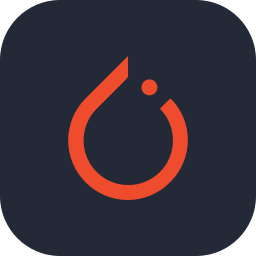 | 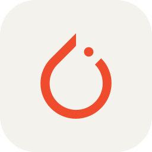 | 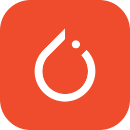 | `pytorch` | PyTorch | - | - | [link](https://github.com/pytorch/pytorch.github.io/blob/381117ec296f002b2de475402ef29cca6c55e209/assets/brand-guidelines/PyTorch-Brand-Guidelines.pdf) |
| 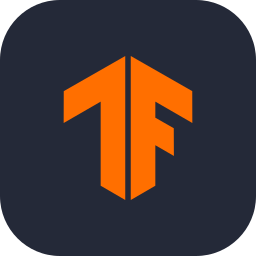 | 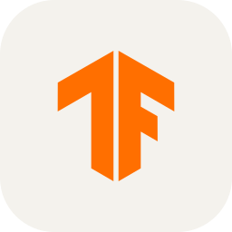 | 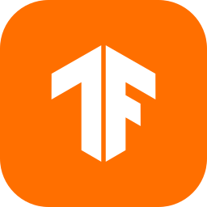 | `tensorflow` | TensorFlow | tf2 | - | - |
| 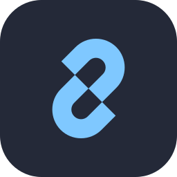 | 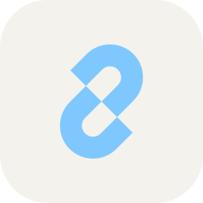 | 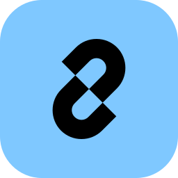 | `langchain` | LangChain | - | - | - |
| 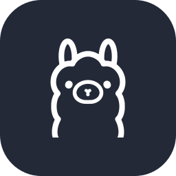 | 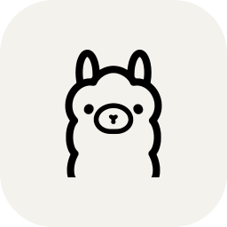 | 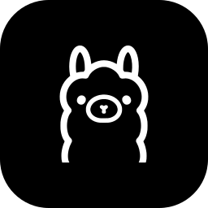 | `ollama` | Ollama | - | - | - |
|  |  |  | `gemini` | Gemini | googlegemini | - | - |
|  |  |  | `mistral` | Mistral AI | mistralai | - | - |
| 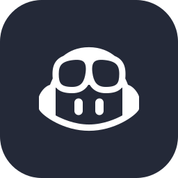 |  | 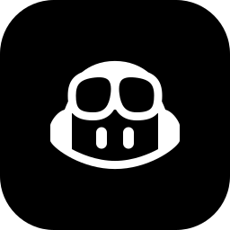 | `copilot` | GitHub Copilot | githubcopilot | MIT | - |
|  |  |  | `kaggle` | Kaggle | - | - | [link](https://www.kaggle.com/brand-guidelines) |
| 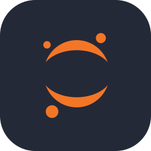 |  |  | `jupyter` | Jupyter | ipynb | - | [link](https://github.com/jupyter/design) |
| 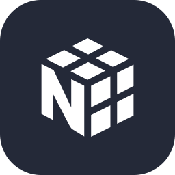 | 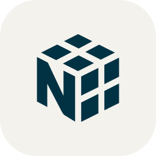 | 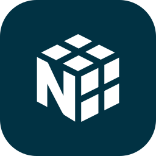 | `numpy` | NumPy | - | - | [link](https://github.com/numpy/numpy/blob/main/branding/logo/logoguidelines.md) |
| 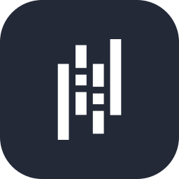 |  |  | `pandas` | pandas | - | - | [link](https://pandas.pydata.org/about/citing.html) |
|  |  |  | `sklearn` | scikit-learn | scikitlearn | - | - |
| 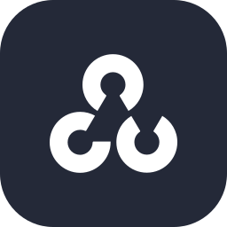 | 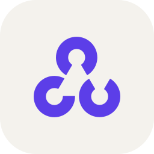 | 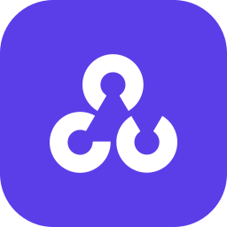 | `opencv` | OpenCV | - | - | [link](https://opencv.org/resources/media-kit/) |

## backend

| Dark | Light | Brand | id | Name | Aliases | Licence | Brand guidelines |
|:-:|:-:|:-:|---|---|---|---|---|
| 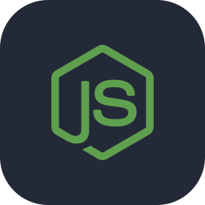 | 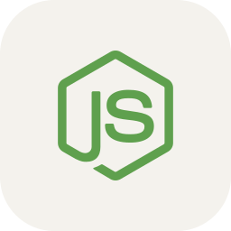 | 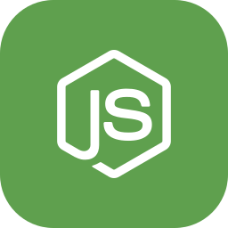 | `nodejs` | Node.js | node | - | [link](https://nodejs.org/en/about/branding) |
| 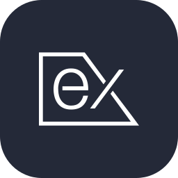 | 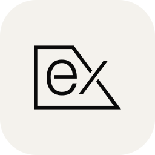 | 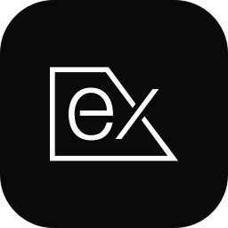 | `express` | Express | expressjs | - | - |
| 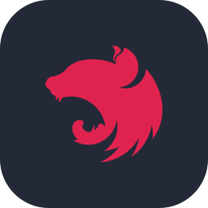 | 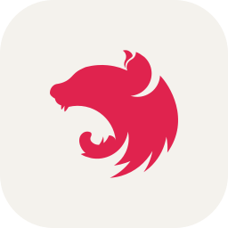 | 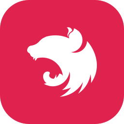 | `nestjs` | NestJS | nest | - | - |
|  |  |  | `django` | Django | - | - | - |
|  |  |  | `flask` | Flask | - | - | - |
| 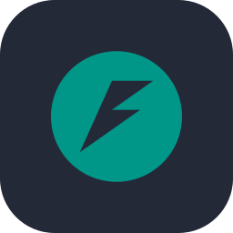 | 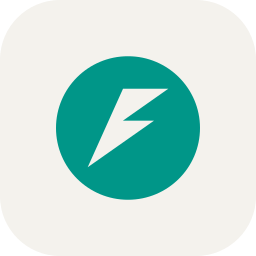 | 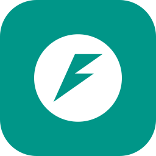 | `fastapi` | FastAPI | - | - | - |
| 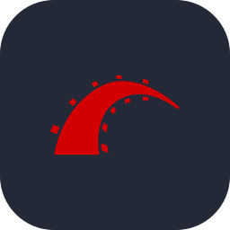 | 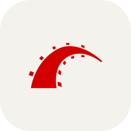 | 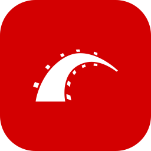 | `rails` | Ruby on Rails | rubyonrails, ror | - | [link](https://rubyonrails.org/trademarks/) |
| 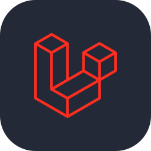 | 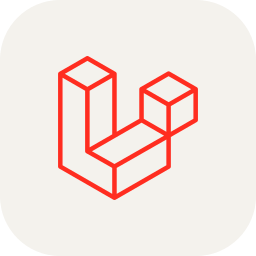 | 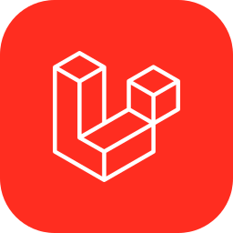 | `laravel` | Laravel | - | - | - |
| 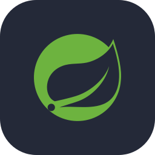 | 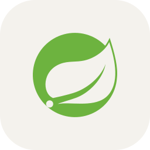 | 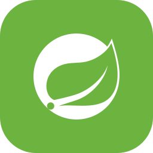 | `spring` | Spring | springboot | - | - |
| 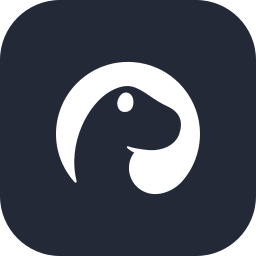 | 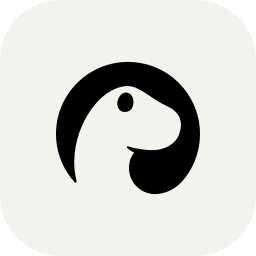 | 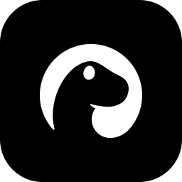 | `deno` | Deno | - | MIT | [link](https://deno.com/brand) |
|  |  |  | `bun` | Bun | bunjs | - | - |
| 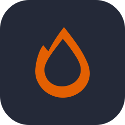 |  |  | `hono` | Hono | - | - | - |
|  | 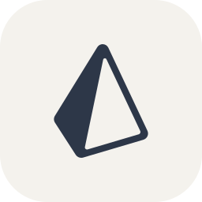 | 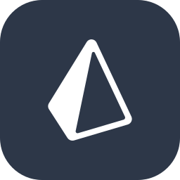 | `prisma` | Prisma | - | - | - |
| 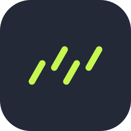 |  |  | `drizzle` | Drizzle | drizzleorm | - | - |
|  |  |  | `trpc` | tRPC | - | - | - |
|  |  |  | `socketio` | Socket.IO | socket.io | - | - |
|  |  |  | `nginx` | NGINX | - | - | [link](https://www.nginx.com/press/) |
|  |  |  | `apache` | Apache | httpd | Apache-2.0 | [link](https://www.apache.org/foundation/marks) |
|  |  |  | `rabbitmq` | RabbitMQ | - | - | [link](https://www.rabbitmq.com/trademark-guidelines.html) |
|  |  |  | `kafka` | Apache Kafka | apachekafka | Apache-2.0 | [link](https://www.apache.org/foundation/marks) |

## cloud

| Dark | Light | Brand | id | Name | Aliases | Licence | Brand guidelines |
|:-:|:-:|:-:|---|---|---|---|---|
|  |  |  | `cloudflare` | Cloudflare | cf, workers | - | [link](https://www.cloudflare.com/trademark/) |
|  |  |  | `vercel` | Vercel | - | - | [link](https://vercel.com/geist/brands) |
|  |  |  | `gcp` | Google Cloud | googlecloud | - | - |
|  |  |  | `netlify` | Netlify | - | - | [link](https://www.netlify.com/press/) |
|  |  |  | `digitalocean` | DigitalOcean | do | - | [link](https://www.digitalocean.com/press/) |
|  |  |  | `firebase` | Firebase | - | - | [link](https://firebase.google.com/brand-guidelines) |
|  |  |  | `render` | Render | - | - | - |
|  |  |  | `railway` | Railway | - | - | - |
|  |  |  | `fly` | Fly.io | flyio | - | [link](https://fly.io/docs/about/brand) |
|  |  |  | `appwrite` | Appwrite | - | - | [link](https://appwrite.io/assets) |

## database

| Dark | Light | Brand | id | Name | Aliases | Licence | Brand guidelines |
|:-:|:-:|:-:|---|---|---|---|---|
|  |  |  | `postgres` | PostgreSQL | postgresql, pg | - | [link](https://www.postgresql.org/about/policies/trademarks/) |
|  |  |  | `mongodb` | MongoDB | mongo | - | - |
|  |  |  | `redis` | Redis | - | - | [link](https://redis.io/brand-guidelines) |
|  |  |  | `supabase` | Supabase | - | - | - |
|  |  |  | `mysql` | MySQL | - | - | [link](https://www.mysql.com/about/legal/logos.html) |
|  |  |  | `sqlite` | SQLite | - | - | - |
|  |  |  | `mariadb` | MariaDB | - | - | [link](https://mariadb.com/about-us/logos/) |
|  |  |  | `cassandra` | Cassandra | - | Apache-2.0 | [link](https://www.apache.org/foundation/marks) |
|  |  |  | `elasticsearch` | Elasticsearch | elastic | - | - |
|  |  |  | `neo4j` | Neo4j | - | - | [link](https://neo4j.com/brand/#logo) |
|  |  |  | `couchdb` | CouchDB | - | Apache-2.0 | [link](https://www.apache.org/foundation/marks) |
|  |  |  | `planetscale` | PlanetScale | - | - | - |
|  |  |  | `clickhouse` | ClickHouse | - | - | - |
|  |  |  | `influxdb` | InfluxDB | - | - | [link](https://influxdata.github.io/branding/logo/usage/) |
|  |  |  | `cockroachdb` | CockroachDB | - | - | - |
|  |  |  | `neon` | Neon | - | - | [link](https://neon.com/brand) |

## design

| Dark | Light | Brand | id | Name | Aliases | Licence | Brand guidelines |
|:-:|:-:|:-:|---|---|---|---|---|
|  |  |  | `figma` | Figma | - | - | [link](https://www.figma.com/using-the-figma-brand/) |
|  |  |  | `blender` | Blender | - | - | [link](https://www.blender.org/about/logo) |
|  |  |  | `unity` | Unity | - | - | [link](https://unity.com/legal/branding-trademarks) |
|  |  |  | `unreal` | Unreal Engine | unrealengine, ue | - | [link](https://www.unrealengine.com/en-US/branding) |
|  |  |  | `godot` | Godot | godotengine | CC-BY-4.0 | [link](https://godotengine.org/press) |
|  |  |  | `inkscape` | Inkscape | - | CC-BY-SA-3.0 | - |
|  |  |  | `gimp` | GIMP | - | CC-BY-SA-4.0 | - |
|  |  |  | `sketch` | Sketch | - | - | [link](https://www.sketch.com/about-us/#press) |
|  |  |  | `framer` | Framer | - | - | - |

## devops

| Dark | Light | Brand | id | Name | Aliases | Licence | Brand guidelines |
|:-:|:-:|:-:|---|---|---|---|---|
|  |  |  | `docker` | Docker | - | - | - |
|  |  |  | `kubernetes` | Kubernetes | k8s | - | - |
|  |  |  | `git` | Git | - | CC-BY-3.0 | - |
|  |  |  | `github` | GitHub | gh | - | [link](https://github.com/logos) |
|  |  |  | `gitlab` | GitLab | - | - | [link](https://about.gitlab.com/handbook/marketing/corporate-marketing/brand-activation/trademark-guidelines/) |
|  |  |  | `bitbucket` | Bitbucket | - | - | [link](https://atlassian.design/foundations/logos) |
|  |  |  | `githubactions` | GitHub Actions | actions, gha | - | - |
|  |  |  | `jenkins` | Jenkins | - | CC-BY-SA-3.0 | [link](https://www.jenkins.io/press/) |
|  |  |  | `circleci` | CircleCI | - | - | - |
|  |  |  | `terraform` | Terraform | tf | - | [link](https://www.hashicorp.com/brand) |
|  |  |  | `ansible` | Ansible | - | - | - |
|  |  |  | `helm` | Helm | - | - | - |
|  |  |  | `prometheus` | Prometheus | - | - | - |
|  |  |  | `grafana` | Grafana | - | - | - |
|  |  |  | `podman` | Podman | - | - | - |
|  |  |  | `argocd` | Argo | argo | - | - |
|  |  |  | `vagrant` | Vagrant | - | - | [link](https://www.hashicorp.com/brand) |
|  |  |  | `sentry` | Sentry | - | - | - |
|  |  |  | `datadog` | Datadog | - | - | [link](https://www.datadoghq.com/about/resources/) |

## frontend

| Dark | Light | Brand | id | Name | Aliases | Licence | Brand guidelines |
|:-:|:-:|:-:|---|---|---|---|---|
|  |  |  | `html` | HTML | html5 | - | - |
|  |  |  | `css` | CSS | css3 | - | [link](https://github.com/CSS-Next/logo.css) |
|  |  |  | `react` | React | reactjs | - | - |
|  |  |  | `nextjs` | Next.js | next | - | [link](https://vercel.com/design/brands#next-js) |
|  |  |  | `vue` | Vue | vuejs | CC-BY-NC-SA-4.0 | [link](https://github.com/vuejs/art/blob/a1c78b74569b70a25300925b4eacfefcc143b8f6/README.md) |
|  |  |  | `svelte` | Svelte | - | - | - |
|  |  |  | `tailwind` | Tailwind CSS | tailwindcss | - | [link](https://tailwindcss.com/brand) |
|  |  |  | `angular` | Angular | angularjs | CC-BY-4.0 | [link](https://angular.dev/press-kit) |
|  |  |  | `astro` | Astro | - | - | - |
|  |  |  | `nuxt` | Nuxt | nuxtjs | - | [link](https://nuxt.com/design-kit) |
|  |  |  | `remix` | Remix | - | - | - |
|  |  |  | `solid` | Solid | solidjs | - | - |
|  |  |  | `qwik` | Qwik | - | - | - |
|  |  |  | `gatsby` | Gatsby | - | - | [link](https://www.gatsbyjs.com/guidelines/logo) |
|  |  |  | `preact` | Preact | - | - | - |
|  |  |  | `lit` | Lit | - | - | - |
|  |  |  | `ember` | Ember.js | emberjs | - | [link](https://emberjs.com/logos/) |
|  |  |  | `jquery` | jQuery | - | - | [link](https://brand.jquery.org/logos/) |
|  |  |  | `htmx` | htmx | - | - | - |
|  |  |  | `alpinejs` | Alpine.js | alpine | - | - |
|  |  |  | `bootstrap` | Bootstrap | - | MIT | [link](https://getbootstrap.com/docs/5.3/about/brand) |
|  |  |  | `sass` | Sass | scss | CC-BY-NC-SA-3.0 | [link](https://sass-lang.com/styleguide/brand) |
|  |  |  | `less` | Less | - | - | - |
|  |  |  | `mui` | MUI | materialui | - | - |
|  |  |  | `chakraui` | Chakra UI | chakra | - | - |
|  |  |  | `shadcn` | shadcn/ui | shadcnui | - | - |
|  |  |  | `styledcomponents` | styled-components | - | - | - |
|  |  |  | `redux` | Redux | - | - | - |
|  |  |  | `threejs` | Three.js | three | - | - |
|  |  |  | `d3` | D3 | d3js | - | - |
|  |  |  | `storybook` | Storybook | - | MIT | - |
|  |  |  | `vite` | Vite | vitejs | - | - |
|  |  |  | `webpack` | webpack | - | custom | [link](https://webpack.js.org/branding) |
|  |  |  | `babel` | Babel | - | - | - |

## language

| Dark | Light | Brand | id | Name | Aliases | Licence | Brand guidelines |
|:-:|:-:|:-:|---|---|---|---|---|
|  |  |  | `js` | JavaScript | javascript | MIT | - |
|  |  |  | `ts` | TypeScript | typescript | - | [link](https://www.typescriptlang.org/branding) |
|  |  |  | `py` | Python | python | - | [link](https://www.python.org/community/logos/) |
|  |  |  | `go` | Go | golang | - | [link](https://blog.golang.org/go-brand) |
|  |  |  | `rust` | Rust | - | CC-BY-SA-4.0 | [link](https://www.rust-lang.org/policies/media-guide) |
|  |  |  | `dotnet` | .NET | net, csharp-runtime | CC0-1.0 | [link](https://github.com/dotnet/brand/blob/c7d0f51b8ec59531332d05fb27a5b758a7a3d689/dotnet-styleGuide-2024.pdf) |
|  |  |  | `c` | C | - | - | - |
|  |  |  | `cpp` | C++ | c++ | - | - |
|  |  |  | `java` | Java | openjdk, jdk | BSD-3-Clause | - |
|  |  |  | `kotlin` | Kotlin | - | - | [link](https://www.jetbrains.com/company/brand/) |
|  |  |  | `swift` | Swift | - | - | [link](https://developer.apple.com/swift/resources/) |
|  |  |  | `php` | PHP | - | CC-BY-SA-4.0 | - |
|  |  |  | `ruby` | Ruby | - | CC-BY-SA-2.5 | - |
|  |  |  | `dart` | Dart | - | - | - |
|  |  |  | `scala` | Scala | - | - | - |
|  |  |  | `elixir` | Elixir | - | - | - |
|  |  |  | `haskell` | Haskell | - | - | - |
|  |  |  | `lua` | Lua | - | - | [link](https://www.lua.org/images/) |
|  |  |  | `r` | R | rlang | CC-BY-SA-4.0 | - |
|  |  |  | `perl` | Perl | - | - | - |
|  |  |  | `julia` | Julia | - | - | - |
|  |  |  | `zig` | Zig | - | CC-BY-SA-4.0 | - |
|  |  |  | `clojure` | Clojure | - | - | - |
|  |  |  | `erlang` | Erlang | - | - | - |
|  |  |  | `ocaml` | OCaml | - | Unlicense | [link](https://ocaml.org/logo) |
|  |  |  | `solidity` | Solidity | - | CC-BY-4.0 | [link](https://docs.soliditylang.org/en/v0.8.6/brand-guide.html) |
|  |  |  | `bash` | Bash | shell, sh | MIT | [link](https://github.com/odb/official-bash-logo) |
|  |  |  | `wasm` | WebAssembly | webassembly | - | - |
|  |  |  | `graphql` | GraphQL | gql | - | [link](https://graphql.org/brand) |
|  |  |  | `markdown` | Markdown | md | CC0-1.0 | [link](https://github.com/dcurtis/markdown-mark) |
|  |  |  | `latex` | LaTeX | tex | - | - |

## mobile

| Dark | Light | Brand | id | Name | Aliases | Licence | Brand guidelines |
|:-:|:-:|:-:|---|---|---|---|---|
|  |  |  | `flutter` | Flutter | - | - | [link](https://flutter.dev/brand) |
|  |  |  | `android` | Android | - | CC-BY-3.0 | [link](https://developer.android.com/distribute/marketing-tools/brand-guidelines#brand-android) |
|  |  |  | `expo` | Expo | - | - | [link](https://expo.dev/brand/) |
|  |  |  | `ionic` | Ionic | - | - | - |
|  |  |  | `capacitor` | Capacitor | - | - | - |
|  |  |  | `electron` | Electron | - | - | - |
|  |  |  | `tauri` | Tauri | - | CC-BY-NC-ND-4.0 | [link](https://github.com/tauri-apps/tauri-docs/blob/b1cdfa9d7c6d0b17dae60a90266ddced40a7b384/static/img/Brand_Guidelines.pdf) |

## os

| Dark | Light | Brand | id | Name | Aliases | Licence | Brand guidelines |
|:-:|:-:|:-:|---|---|---|---|---|
|  |  |  | `linux` | Linux | - | - | - |
|  |  |  | `apple` | Apple | macos, mac, ios | - | - |
|  |  |  | `ubuntu` | Ubuntu | - | - | [link](https://design.ubuntu.com/brand) |
|  |  |  | `debian` | Debian | - | CC-BY-SA-3.0 | [link](https://www.debian.org/logos/) |
|  |  |  | `arch` | Arch Linux | archlinux | - | [link](https://wiki.archlinux.org/index.php/DeveloperWiki:TrademarkPolicy#Logo_Usage_Guidelines) |
|  |  |  | `fedora` | Fedora | - | custom | [link](https://fedoraproject.org/wiki/Legal:Trademark_guidelines) |
|  |  |  | `raspberrypi` | Raspberry Pi | rpi | - | [link](https://www.raspberrypi.org/trademark-rules) |

## tools

| Dark | Light | Brand | id | Name | Aliases | Licence | Brand guidelines |
|:-:|:-:|:-:|---|---|---|---|---|
|  |  |  | `vim` | Vim | - | - | - |
|  |  |  | `neovim` | Neovim | nvim | CC-BY-SA-3.0 | - |
|  |  |  | `idea` | IntelliJ IDEA | intellij | - | [link](https://www.jetbrains.com/company/brand/) |
|  |  |  | `postman` | Postman | - | - | - |
|  |  |  | `insomnia` | Insomnia | - | - | - |
|  |  |  | `npm` | npm | - | - | [link](https://docs.npmjs.com/policies/logos-and-usage) |
|  |  |  | `yarn` | Yarn | - | CC-BY-4.0 | [link](https://github.com/yarnpkg/assets/tree/76d30ca2aebed5b73ea8131d972218fb860bd32d) |
|  |  |  | `pnpm` | pnpm | - | - | - |
|  |  |  | `jest` | Jest | - | - | - |
|  |  |  | `vitest` | Vitest | - | - | - |
|  |  |  | `cypress` | Cypress | - | - | - |
|  |  |  | `selenium` | Selenium | - | - | - |
|  |  |  | `eslint` | ESLint | - | - | - |
|  |  |  | `prettier` | Prettier | - | - | - |
|  |  |  | `notion` | Notion | - | - | - |
|  |  |  | `discord` | Discord | - | - | [link](https://discord.com/branding) |
|  |  |  | `jira` | Jira | - | - | [link](https://atlassian.design/foundations/logos/) |
|  |  |  | `obsidian` | Obsidian | - | - | [link](https://obsidian.md/brand) |
|  |  |  | `stackoverflow` | Stack Overflow | so | - | [link](https://stackoverflow.com/legal/trademark-guidance) |
|  |  |  | `homebrew` | Homebrew | brew | - | - |
